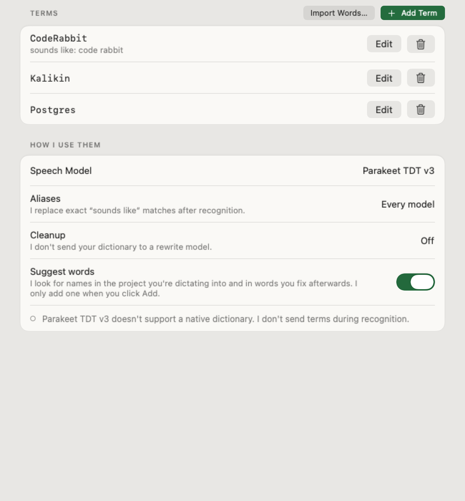
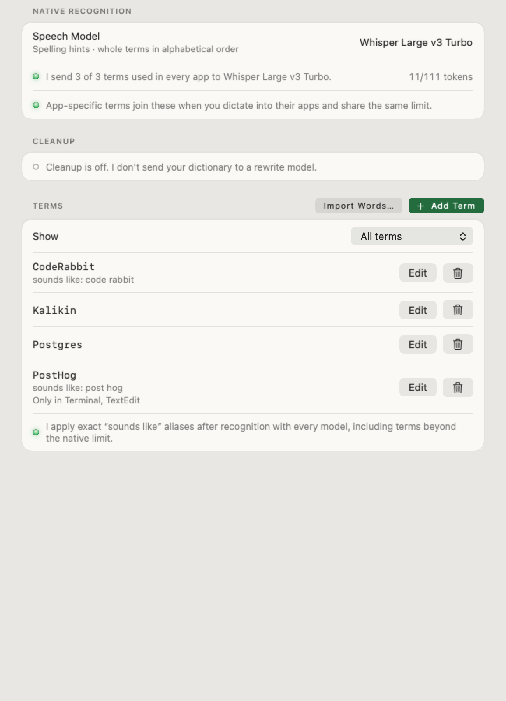
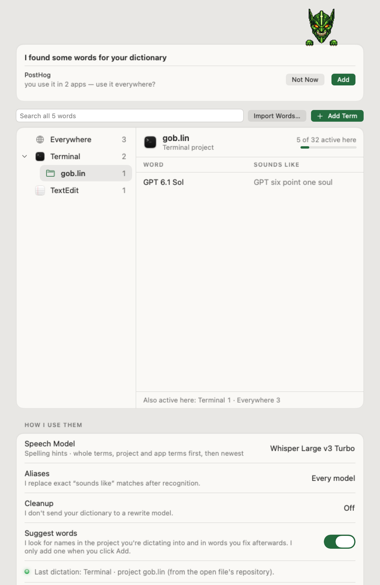
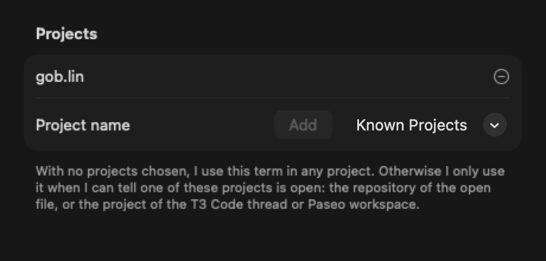
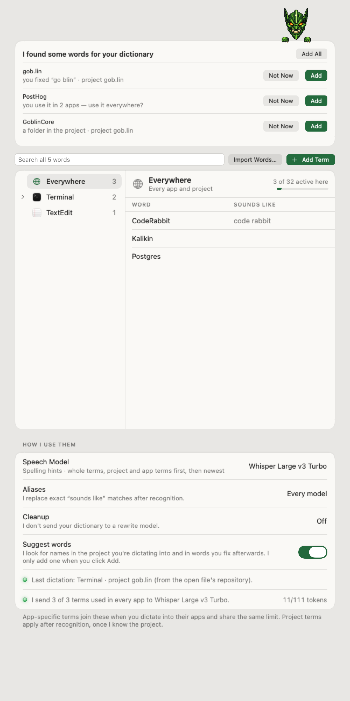

# Dictionary

`DictionaryRepository.applicationDefault` persists only user-authored entries in Application Support/gob.lin/dictionary.json. Load failures never overwrite the existing file. Changes are validated, then saved atomically. Plain-text import accepts one preferred spelling per line and ignores duplicate spellings.

`DictionaryCorrector.correct(_:entries:allowFuzzy:)` returns text and an audit list of corrections. Only explicitly authored aliases cause exact replacements. They match whole Unicode words and whitespace-separated phrases, never across punctuation. Existing preferred spellings are no-change lockouts before fuzzy matching; they do not implicitly capitalize ordinary prose such as “go”, “swift”, or “linear”. Overlapping aliases choose the longest phrase.

An all-caps input must contain at least one uppercase letter; caseless scripts keep the preferred spelling rather than shouting a Latin replacement. Explicit uppercase input stays uppercase. Mixed-case brand spellings such as `iPhone` stay intact. An alias at sentence start capitalizes the replacement's first letter only when the entire preferred spelling is lowercase (`npm` → `Npm`). Fuzzy edits otherwise preserve the input capitalization.

Code in inline backticks or fenced blocks, including whitespace and newlines, is protected before any matching. Conservative whitespace chunks containing URL/email/path/snake_case syntax, dotted/hyphenated/colon-separated identifiers, or camelCase are also protected. Leading/trailing sentence punctuation stays a normal word boundary. This deliberately favors leaving ambiguous code-like text unchanged and can skip correction inside hyphenated prose; it is not a full source-code parser.

Fuzzy correction defaults **off**. Its opt-in implementation permits a unique one-edit match only when the original input token and original preferred term each have five or more characters; case folding is used only for comparison, so a four-character `Groß` cannot qualify by expanding to `gross`. It protects a broad common-English vocabulary and preserves capitalization. A finite deny list cannot guarantee safety for every English word, so the production pipeline must retain the default until the real replay proves zero ordinary-word regressions. There is no Soundex and no automatic learning: gob.lin [suggests terms](#suggestions), but every one needs a click.

All integrated Whisper models accept preferred spellings as native recognition hints. Other models, Parakeet included, do not use the dictionary during recognition ([why](#no-parakeet-correction)); aliases and Cleanup spell terms for every model. Dictionary settings show the selected model's support separately from Cleanup use, and Model Details shows which mechanism each model uses.

Each dictation uses at most 32 active terms (`DictionaryScope.activeLimit`) for Whisper's prompt and Cleanup's prompt, most specific first: terms for the project and app, then the project, then the app, then everywhere, newest first within each. In the [evaluation](evaluation/dictionary-biasing.md), longer lists cost names; 32 is a starting point between the measured 16 and 120. Aliases still use every active term. The pinned Whisper decoder accepts 111 prompt tokens. The shared planner uses that model's local tokenizer, includes comma separators, and fits whole preferred spellings in that order. It stops at the first term that would overflow; neither a partial term nor later terms jump the cutoff. Settings show the included count, token usage, cutoff and excluded entries. Without a prepared tokenizer, settings ask to prepare the model instead of estimating a word limit. Recognition remains probabilistic: hints can help names and can also change ordinary words.

Each dictation snapshots its vocabulary with its model/language options before capture. Live windows, original-file recovery and history retranscription use those options without sharing mutable vocabulary between requests. Word alignment accounts for the prompt prefix, preserving timestamps for live merging. Empty dictionaries retain the unprompted decoding path.

## No Parakeet correction

Earlier versions corrected Parakeet v3, Ultra, Redux and Phonon-2 transcripts after recognition: a separately downloaded CTC 110M model rescored the audio for dictionary terms, behind a spelling guard and text join. It was removed in favour of aliases and Cleanup:

- **It replaced correct words.** On synthetic clips it recovered more names than Cleanup alone ([evaluation](evaluation/dictionary-biasing.md#other-parakeet-models)). Replaying 120 real dictations with one global term, it changed text 7 times, every time wrongly: each time the term replaced correctly heard words, such as a product name. Cleanup can't restore context that a replacement removed.
- **It cost latency.** Its extra pass added about 110–160 ms, and it had to see a whole utterance at once, so after a pause or past 15 seconds of speech the recording was recognized again at key-up instead of using the live transcript.

For a word recognition keeps getting wrong, add what you hear as a "sounds like" alias. Cleanup receives the preferred spelling either way.

Exact aliases continue to work for every model and every active entry. When Cleanup is enabled at a non-None level, its prompt receives the active preferred spellings, including those excluded from native recognition. Adding dictionary terms never enables Cleanup.

## App scopes

An entry can be limited to apps by bundle identifier (`apps`; empty means every app). Each dictation uses the entries for the app that was frontmost when it started, plus every unscoped entry. The same set drives native recognition, exact aliases and Cleanup's preferred spellings. Dictating while gob.lin itself is frontmost uses unscoped entries only. History records that app with each entry, separately from the app the text was delivered to, and rewrite and retranscription reuse it; entries saved before this fall back to their target app. A spelling or alias still belongs to one entry, which can list several apps.

Files without `apps` load as unscoped. A dictionary with no scoped entries is still saved as version 1 without the key, so earlier versions read it unchanged. Once any entry is scoped the file is saved as version 2: earlier versions report the dictionary as unavailable and leave the file intact rather than drop the scopes.

Settings choose apps from the open apps or any application bundle, show “Only in …” under scoped terms, and filter the list by app. The native capacity preview covers unscoped terms; app terms join them in their apps and share the limit. CLI `transcribe` and `replay` accept `--app <bundle-id>` to select the same set.

Why scope: in the [dictionary evaluation](evaluation/dictionary-biasing.md), Cleanup given the 16 relevant terms recovered 86/96 names on unseen clips against 74/96 with all 120 terms, and the since-removed Parakeet correction lost names with the longer list too. Neither list changed ordinary sentences, so a wrong or missing scope costs recall rather than introducing errors.

## Project scopes

Dictionaries layer: unscoped terms apply everywhere, app terms apply in their apps with no further setup, and an entry can also list `projects`. A project-scoped entry applies only when its app matches (or it has no apps) and the detected project matches one of its names. Names compare by their last path component, ignoring case and diacritics, so `gob.lin`, `akalikin/gob.lin` and a checkout path are the same project.

Detection runs when some entry lists projects or [suggestions](#suggestions) are on, and in the background from the start of dictation, so it never delays recording. Within a 1.5 s budget and node limits it reads, in order:

- the focused window's document (editors and some terminals): the name of the enclosing git repository;
- T3 Code: the thread in the page address, looked up read-only in `~/.t3/userdata/statev2.sqlite`; threads from remote environments fall back to the "New thread in <project>" button;
- Paseo: the workspace in the page address, looked up in `~/.paseo/projects`; workspaces on other hosts fall back to the one sidebar row styled differently from the rest. This fallback depends on Paseo's markup and gives no answer when the styling is ambiguous.

T3 Code and Paseo are Electron apps, so gob.lin sets `AXManualAccessibility` on them to read their page. Results are cached by document or page address, except Paseo's sidebar fallback. Aliases and Cleanup wait at most 0.3 s after speech ends for a result (20 ms when no term lists a project; suggestions then wait for it in the background); without one, project terms are left out, so a missed detection costs recall rather than introducing wrong terms. Native recognition (Whisper's prompt) uses app-scoped terms only, because the project is not known when decoding starts.

History records the detected project with the app, and reprocessing reuses both. Settings add a Projects list to each term with suggestions from the last dictation, existing scopes and local T3 Code and Paseo projects, show the project under scoped terms, filter by project and report what the last dictation detected. CLI `transcribe` and `replay` accept `--project <name>` alongside `--app`. Files with project scopes are saved as version 3, because the app-scoped release reads version 2 but would ignore `projects` and widen those terms to every project; it reports a version 3 dictionary as unavailable and leaves the file intact.

Measured on one Mac with WindowProbe running the shipped detector: Zed file → repository in 7 ms, T3 Code thread → database in 7 ms (1 ms cached), remote Paseo workspace → sidebar in about 95 ms. Ghostty exposes no document, so terminals without one give no project.

## Suggestions

The goblin offers terms for the places you dictate into; nothing is added until you click Add (or Add All). `TermSuggestions` in GoblinCore finds them and the Dictionary page shows them on a card above the terms, with a "3 new words for gob.lin" line in the popover header. The "Suggest words" switch on the Dictionary page turns them off; it is on by default.

Sources:

- **The detected project's folder**, read at most every 10 minutes per folder, at the top level only: the project's name, the package name from `Package.swift`, `package.json`, `Cargo.toml`, `pyproject.toml` or `go.mod`, top-level folder names (not dotfiles, build output or common names such as `src`), and the words of author names in the last 300 commits. git runs only from Homebrew or the active developer directory, never through the `/usr/bin/git` shim that asks to install developer tools.
- **Your fixes.** When "Watch edits after paste" sees you replace 1–3 dictated words with 1–3 others ("go blin" → "gob.lin"), the new words become a term with the old ones as a "sounds like" alias. A fix that only re-spaces or recases ("post hog" → "PostHog") needs no alias, and a single ordinary word is never offered as one, since it would replace that word everywhere. These are kept in memory until gob.lin quits.

A suggestion must look like a term: at least three letters and a word the macOS spell checker doesn't know, mixed case inside a word, a digit, or an inner dot. Terms already used in that place, and suggestions you dismiss with Not Now (remembered by spelling and place), aren't offered again. At most 8 show, fixes first.

Scoping starts narrow and widens on evidence. Repository terms, and fixes made while a project was detected, apply to that project only; fixes with no project apply to that app. The same spelling in a second project (or app) is offered there too; once it is in two or more, or in a project and an app, the suggestion becomes "use it everywhere?". Apps and projects combine with AND, so an app is never merged into a project term, which would narrow it. A place that already has `DictionaryScope.activeLimit` active terms gets no new ones, only "everywhere" suggestions. Add Term starts scoped the same way: the last dictation's project, otherwise its app.

CLI `transcribe` and audio `replay` use the default dictionary, or the JSON file selected with `--dictionary`. Whisper models receive the same native prompt; `transcribe` reports included/excluded terms and token usage in `dictionaryUsage`. Recorded-transcript replay does not run recognition. `dictionary-eval` compares Whisper prompting and a CLI-only Moonshine key-term diagnostic against recognition without terms. See [Dictionary biasing evaluation](evaluation/dictionary-biasing.md).

Validation: `swift test` covers dictionary safety/storage and suggestion sources, filtering, widening, the budget and accepting. `scripts/check-models.sh` checks capacity boundaries, priority ordering, the active limit, backend gating (only Whisper sessions receive terms), immutable session options, alignment offsets and the system spell checker. Its `--dictionary-real <model-directory> <audio-file> [--model <id>] [--long-file <audio-file>]` mode checks installed Whisper file/PCM inference, word timing, tokenizer preview agreement, automatic language detection, silence and request isolation using supplied recordings. `--capture-dictionary <output-directory> <turbo-model-directory>` renders the production settings views offscreen, including app- and project-scoped terms and the suggestion card, and checks that dismissing, accepting and switching suggestions off work. `scripts/check-dictionary-suggestions.sh` runs suggestions live in a probe signed like the app, with an isolated dictionary, history and preferences: it speaks two sentences through the speakers into TextEdit with the real hotkey, detects the fixture repository from the open file, checks its suggestions, respells the transcribed name in TextEdit, waits for the edit watcher's correction suggestion, accepts it and checks the next dictation records the project. It needs the signing identity's microphone and Accessibility grants, a quiet room and gob.lin quit. These checks do not establish accuracy on a user's real dictations.
